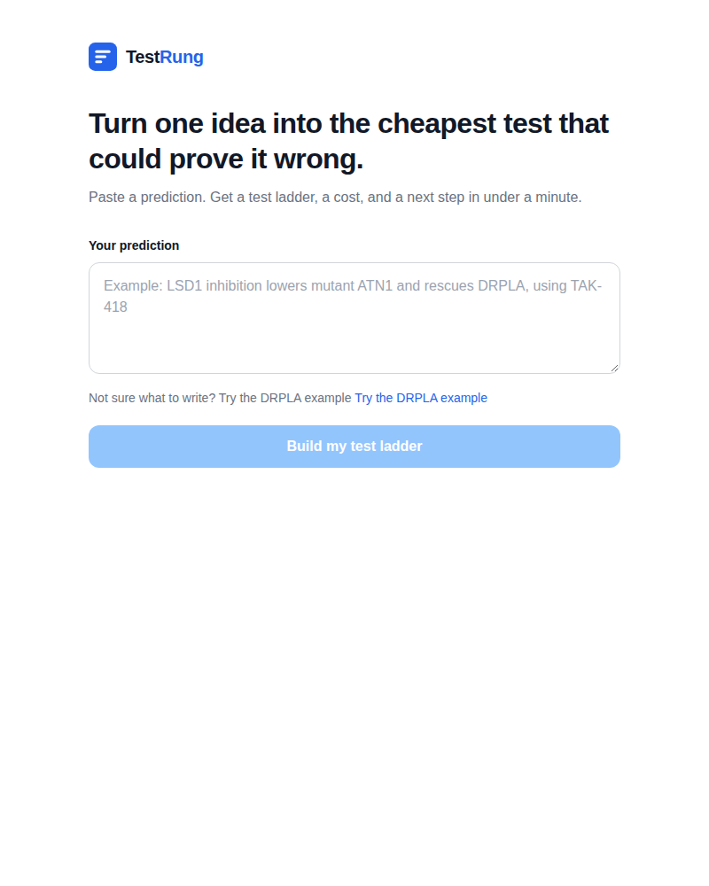
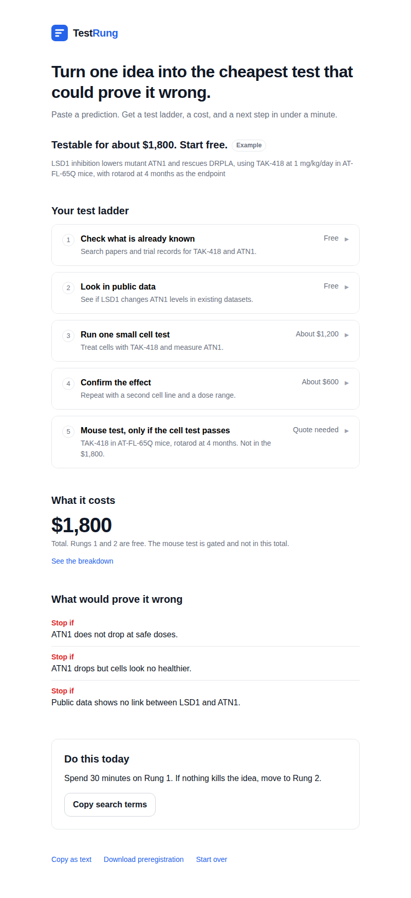
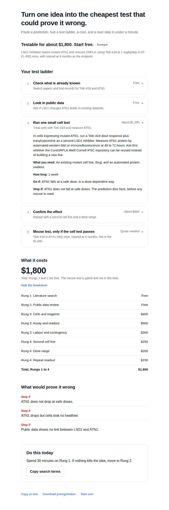
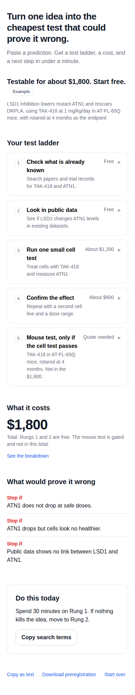
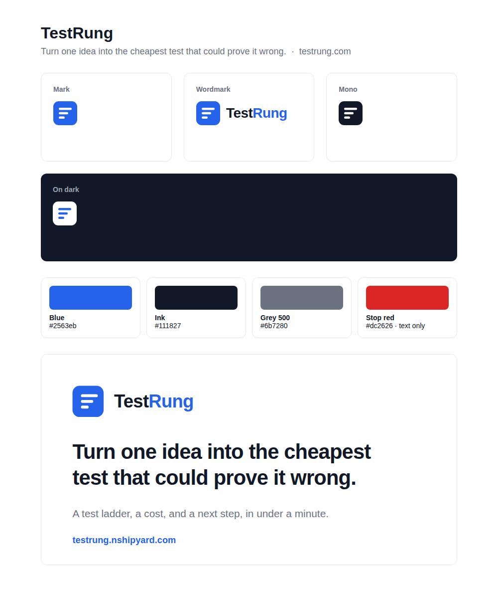

<p align="center">
  
</p>

<h1 align="center">TestRung</h1>

<p align="center"><strong>Convierte una idea en la prueba más barata que podría demostrar que está equivocada.</strong></p>

<p align="center">
  Una escalera de pruebas, un costo y un próximo paso, en menos de un minuto.<br>
  Para investigadores de enfermedades raras, laboratorios sin financiación y cualquier persona que tenga que probar una idea antes de poder permitirse creer en ella.
</p>

<p align="center">
  <a href="LICENSE"></a>
  
  
  
  
</p>

<p align="center">
  <a href="#try-it-in-2-minutes"><strong>Pruébalo en 2 minutos</strong></a> ·
  <a href="#how-it-works">Cómo funciona</a> ·
  <a href="#the-drpla-example">El ejemplo de DRPLA</a> ·
  <a href="#where-is-it-cheapest-to-run">El lugar más barato para ejecutarla</a> ·
  <a href="#contributing">Contribuir</a>
</p>

<p align="center">
  Leer en: <a href="README.md">English</a> · <a href="README.fr.md">Français</a> · Español
</p>

---

## El problema

Una prueba de laboratorio es cara mucho antes de ser difícil. Criar y alojar ratones durante cuatro meses, dosificarlos a diario, hacer pruebas de comportamiento y pagar manos expertas cuesta mucho más que el fármaco. La mayoría de las predicciones nunca se prueban, no porque sean erróneas, sino porque la primera prueba que alguien propone es la más cara.

TestRung empieza por el extremo opuesto. Pregunta: ¿cuál es la prueba más barata que podría demostrar que esta idea está equivocada, y cuánto cuesta?

Este proyecto nació de un caso real. RareGap predijo que inhibir LSD1 reduciría la atrofina-1 mutante y rescataría la DRPLA, una enfermedad neurodegenerativa rara. La prueba se redactó y se envió al laboratorio Ross de Johns Hopkins. El laboratorio respondió que estaría encantado de asesorar, pero que no tenía fondos disponibles para ejecutar el experimento. Ese es el caso normal, no la excepción. TestRung está construido para eso.

## Cómo funciona

Pega una predicción. Obtén una escalera, de la más barata a la más cara.

1. **Pega una predicción**, o toca "Try the DRPLA example".
2. **Toca "Build my test ladder".**
3. **Lee primero el veredicto.** Una línea, un costo total.
4. **Abre un peldaño a la vez**, del más barato al más caro. Los peldaños 1 y 2 son gratuitos.
5. **Lee qué acabaría con la idea.** Cada escalera enumera sus criterios de "Stop if".
6. **Haz hoy el próximo paso.** La aplicación te dice qué hacer en los próximos 30 minutos, y te da los términos de búsqueda para hacerlo.

Sin cuenta. Sin panel de control. Sin ajustes. Una pantalla, una acción.



## El ejemplo de DRPLA

El ejemplo precargado es la predicción real de RareGap:

> La inhibición de LSD1 reduce la ATN1 mutante y rescata la DRPLA, con TAK-418 a 1 mg/kg/día en ratones AT-FL-65Q, y rotarod a los 4 meses como criterio de valoración

La escalera que produce:

| Peldaño | Prueba | Costo |
| --- | --- | --- |
| 1 | Comprueba lo que ya se sabe. Busca artículos y registros de ensayos sobre TAK-418 y ATN1. | Gratis |
| 2 | Mira los datos públicos. Comprueba si LSD1 cambia los niveles de ATN1 en los conjuntos de datos existentes. | Gratis |
| 3 | Ejecuta una pequeña prueba celular. Trata las células con TAK-418 y mide ATN1. | Alrededor de $1,200 |
| 4 | Confirma el efecto. Repite con una segunda línea celular y un rango de dosis. | Alrededor de $600 |
| 5 | Prueba en ratones, solo si la prueba celular supera el filtro. TAK-418 en ratones AT-FL-65Q, rotarod a los 4 meses. | Se necesita presupuesto, bloqueado |

**Total, peldaños 1 a 4: alrededor de $1,800.** La prueba en ratones no está incluida en el total. Está bloqueada hasta que la prueba celular la supere, porque si ATN1 no disminuye en las células, el gasto en ratones es un desperdicio.



Qué demostraría que está equivocada:

- **Stop if** ATN1 no disminuye a dosis seguras.
- **Stop if** ATN1 disminuye pero las células no se ven más sanas.
- **Stop if** los datos públicos no muestran ningún vínculo entre LSD1 y ATN1.



El desglose de costos está a un toque de distancia, línea por línea. Nada se esconde en una cifra redonda.



## ¿Dónde es más barato ejecutarla?

La próxima función, diseñada con Opus 5.5, es una comparación al estilo de Numbeo para cada peldaño: ¿dónde del mundo es más barato ejecutar esta prueba, y es real el ahorro?

La versión honesta, no una tabla de clasificación. Diseño completo en [`docs/cheapest-place-brainstorm.md`](docs/cheapest-place-brainstorm.md). La versión corta:

- **Clasifica proveedores, no naciones.** El costo varía más entre proveedores que entre países. Un centro universitario en España y una CRO en China no son el mismo tipo de fila.
- **Ordena por costo total de llegada.** Precio, más envío y aduanas, más una repetición prevista. El tiempo hasta el resultado es su propia columna, nunca se convierte en dólares.
- **Cada precio lleva una etiqueta.** Quote, Published rate, Estimate o Placeholder. Una fila sin base muestra "Quote needed" en lugar de una cifra inventada.
- **Tres filas como máximo**, con la referencia de EE. UU. siempre fijada. No hay una lista clasificada de 40 países.
- **Solo los peldaños 3 y 4, en la v1.** El peldaño del ratón recibe "Where can this run? (quote only)", con el plazo de ética y sin precios, porque ahí es donde los datos son más escasos y la trampa es mayor.

El ejemplo, para la prueba celular de DRPLA:

| Lugar | Costo total | Resultado en | Base |
| --- | --- | --- | --- |
| EE. UU., centro académico o CRO (referencia) | $1,200 | 3 sem | Estimate |
| España o Portugal, centro universitario | ~$780 | 5 sem | Estimate |
| China, CRO por contrato | Quote needed | 4 a 6 sem | Placeholder, no se muestra ninguna cifra |

Los reactivos cuestan más o menos lo mismo en todas partes. Los ahorros vienen de la mano de obra. Esa es toda la idea, y el diseño lo dice en una línea.

Si tienes un precio real, una tarifa publicada de un centro o un presupuesto con fecha, esa es la contribución más valiosa que puedes hacer. Ver [Contribuir](#contributing).

## Pruébalo en 2 minutos

Necesitas Node 20 o una versión más reciente. Nada más.

```bash
git clone https://github.com/richardsondx/testrung.git
cd testrung
npm install
npm run dev
```

Abre http://localhost:3000

Eso es toda la configuración. No hay base de datos, ni clave de API, ni cuenta que crear.

Para ejecutar la compilación de producción:

```bash
npm run build
npm start
```

## Qué es esto, y qué no es

**Es:**

- Una escalera determinista y basada en reglas en [`lib/ladder.ts`](lib/ladder.ts). La escalera, los costos y los criterios de descarte se pueden comprobar sin confiar en un modelo.
- Un borrador de preregistro que puedes descargar, y una copia en texto plano de la escalera.
- Código abierto, con licencia MIT. Úsalo, haz un fork, enséñalo.

**No es:**

- Una llamada a un modelo. La v1 no llama a ningún modelo de IA y no almacena nada en un servidor. La interfaz de generación en [`lib/generate.ts`](lib/generate.ts) es el único lugar donde se conecta un modelo para la v2, con Gemini 4 Neon como primer generador previsto.
- Un presupuesto de un laboratorio real. Los costos son estimaciones de planificación, no presupuestos. Un laboratorio debe revisar el borrador de preregistro antes de usarlo.
- Un sustituto de la prueba en ratones. Un resultado celular que se ve bien no garantiza un rescate en el cerebro. La escalera es un filtro, no un reemplazo.

## Para quién es

- **Investigadores de enfermedades raras** con una predicción y sin presupuesto para el estudio completo en animales.
- **Laboratorios sin financiación y equipos pequeños** que necesitan descartar ideas malas a bajo costo y gastar en las que sobreviven.
- **Equipos de descubrimiento de fármacos y preclínicos** que quieren un primer paso falsable y preregistrado antes de pedir un presupuesto a una CRO.
- **Estudiantes y docentes** que quieren un ejemplo concreto de falsación, diseño experimental y las 3R (reemplazar, reducir y refinar el uso de animales).
- **Colaboradores de ciencia abierta** que pueden añadir un precio real, un peldaño mejor o un criterio de descarte más claro.

Palabras clave: enfermedad rara, DRPLA, preclínico, descubrimiento de fármacos, falsación, diseño experimental, ciencia abierta, costo de laboratorio, ensayo celular, reducción de animales, 3R, preregistro, reproducibilidad, CRO, centro de servicios.

## Estructura del proyecto

```
app/page.tsx       todo el flujo, una pantalla
app/globals.css    el sistema visual, CSS plano, sin biblioteca de componentes
app/icon.svg       el favicon de TestRung
components/Logo.tsx  la marca y el logotipo de TestRung
lib/ladder.ts      el motor de la escalera, el modelo de costos, los criterios de descarte, el texto exportado
lib/generate.ts    la interfaz de generación, lista para Gemini 4 Neon en la v2
lib/strings.ts     todo el texto visible para el usuario, en un solo lugar
brand/             logotipo, marca, favicon, tarjeta social, guía de marca
docs/              lluvia de ideas sobre el lugar más barato, notas de diseño
screenshots/        la muestra visual usada en este README
ARCHITECTURE.md    arquitectura, y una nota honesta sobre el intento con Neon
```

## Marca

TestRung. Cuadrado azul redondeado, tres barras blancas que se acortan de izquierda a derecha, el costo baja. Tinta `#111827`, Azul `#2563eb`, Gris 500 `#6b7280`, rojo `#dc2626` solo para el texto "Stop if". Tipografía Inter o del sistema. Guía completa en [`brand/BRAND.md`](brand/BRAND.md).



Dominio: **testrung.nshipyard.com**. No hay que comprar un dominio nuevo, es un subdominio de nshipyard.com, que se apuntará al servidor cuando se despliegue.

## Contribuir

Las contribuciones son bienvenidas, y las pequeñas son las mejores. La contribución más valiosa es un precio real con una fuente y una fecha.

Lee [`CONTRIBUTING.md`](CONTRIBUTING.md) primero. En resumen: haz un fork, crea una rama desde `main`, mantén la compilación en verde (`npm run build`), mantén la interfaz mínima, nunca inventes un número, y abre una pull request con un solo cambio.

Lo que más ayuda, en orden: un precio real, un peldaño mejor, un criterio de descarte, una corrección de errores, una frase más clara.

## Autor

**Richardson Dackam**, fundador de [RareGap](https://raregap.ai), constructor y pensador de sistemas.

- GitHub: [github.com/richardsondx](https://github.com/richardsondx)
- LinkedIn: [linkedin.com/in/richardsondx](https://www.linkedin.com/in/richardsondx)
- Proyecto: [RareGap](https://raregap.ai)

TestRung empezó como Cheap-Test Converter, creado después de que el laboratorio Ross de Johns Hopkins dijera que asesoraría sobre la prueba de DRPLA pero que no tenía fondos disponibles para ejecutarla.

## Licencia

MIT. Ver [LICENSE](LICENSE). Copyright 2026 Richardson Dackam.

## Agradecimientos

Creado para [RareGap](https://raregap.ai), que convierte la biología de las enfermedades raras en hipótesis clasificadas y comprobables. La predicción de DRPLA y el intercambio con el laboratorio Ross son la razón por la que existe esta herramienta. Especificación de interfaz por Opus 5.5. Diseño del lugar más barato por Opus 5.5. Las notas de arquitectura en [`ARCHITECTURE.md`](ARCHITECTURE.md) son honestas sobre lo que Gemini 4 Neon hizo y no hizo en el primer intento.
