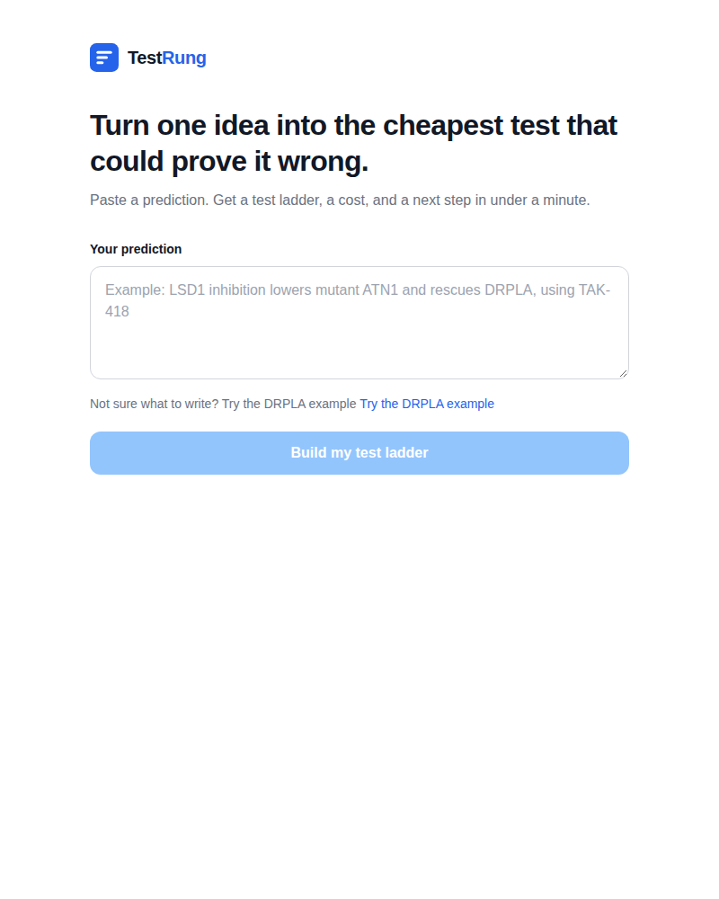
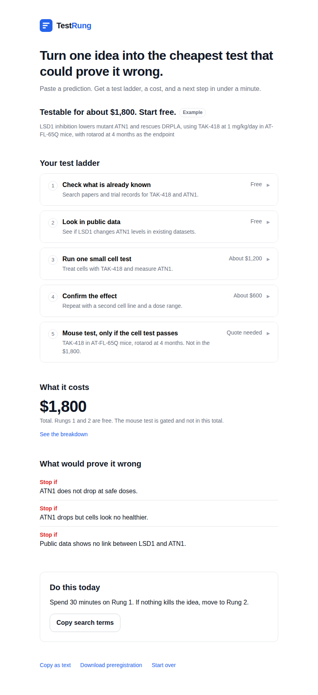
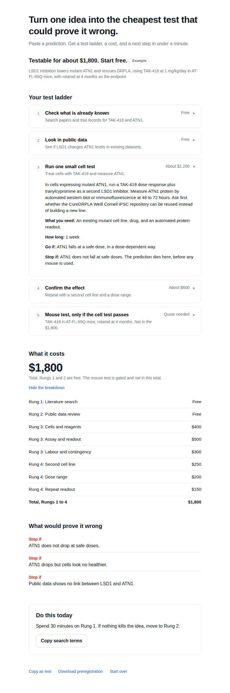
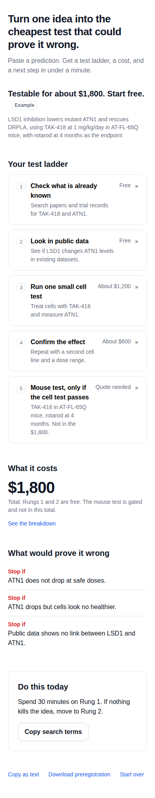
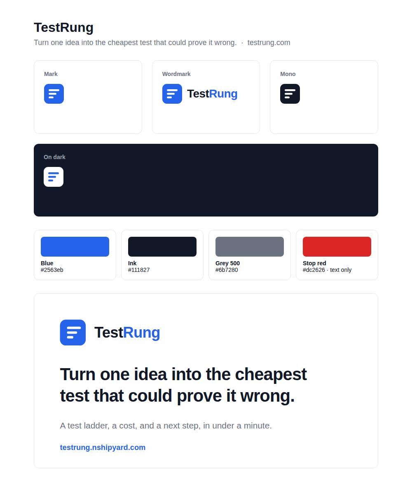

<p align="center">
  
</p>

<h1 align="center">TestRung</h1>

<p align="center"><strong>Transformez une idée en le test le moins cher qui pourrait la réfuter.</strong></p>

<p align="center">
  Une échelle de tests, un coût et une prochaine étape, en moins d'une minute.<br>
  Pour les chercheurs en maladies rares, les laboratoires sans financement et toutes les personnes qui doivent prouver une idée avant de pouvoir se permettre d'y croire.
</p>

<p align="center">
  <a href="LICENSE"></a>
  
  
  
  
</p>

<p align="center">
  <a href="#try-it-in-2-minutes"><strong>Essayez-le en 2 minutes</strong></a> ·
  <a href="#how-it-works">Comment ça marche</a> ·
  <a href="#the-drpla-example">L'exemple DRPLA</a> ·
  <a href="#where-is-it-cheapest-to-run">Où le réaliser au meilleur prix</a> ·
  <a href="#contributing">Contribuer</a>
</p>

<p align="center">
  Lire en : <a href="README.md">English</a> · Français · <a href="README.es.md">Español</a>
</p>

---

## Le problème

Un test de laboratoire coûte cher bien avant d'être difficile. Élever et héberger des souris pendant quatre mois, les doser chaque jour, réaliser des tests comportementaux et mobiliser des mains qualifiées coûtent bien plus cher que le médicament. La plupart des prédictions ne sont jamais testées, non pas parce qu'elles sont fausses, mais parce que le premier test proposé est le plus cher.

TestRung part de l'autre extrémité. Il pose la question : quel est le test le moins cher qui pourrait réfuter cette idée, et combien coûte-t-il ?

Ce projet est né d'un cas réel. RareGap a prédit que l'inhibition de LSD1 réduirait l'atrophine-1 mutante et sauverait la DRPLA, une maladie neurodégénérative rare. Le test a été rédigé et envoyé au laboratoire Ross de Johns Hopkins. Le laboratoire a répondu qu'il serait heureux de donner des conseils, mais qu'il n'avait pas de fonds disponibles pour réaliser l'expérience. C'est le cas normal, pas l'exception. TestRung est conçu pour cela.

## Comment ça marche

Collez une prédiction. Obtenez une échelle, de la moins chère à la plus chère.

1. **Collez une prédiction**, ou appuyez sur « Try the DRPLA example ».
2. **Appuyez sur « Build my test ladder ».**
3. **Lisez d'abord le verdict.** Une ligne, un coût total.
4. **Ouvrez un échelon à la fois**, du moins cher au plus cher. Les échelons 1 et 2 sont gratuits.
5. **Lisez ce qui réfuterait l'idée.** Chaque échelle énumère ses critères « Stop if ».
6. **Faites la prochaine étape aujourd'hui.** L'application vous dit quoi faire dans les 30 prochaines minutes, et vous donne les termes de recherche pour le faire.

Aucun compte. Aucun tableau de bord. Aucun réglage. Un seul écran, une seule action.



## L'exemple DRPLA

L'exemple préchargé est la vraie prédiction de RareGap :

> L'inhibition de LSD1 réduit l'ATN1 mutante et sauve la DRPLA, avec du TAK-418 à 1 mg/kg/jour chez des souris AT-FL-65Q, et le rotarod à 4 mois comme critère d'évaluation

L'échelle qu'il produit :

| Échelon | Test | Coût |
| --- | --- | --- |
| 1 | Vérifiez ce qui est déjà connu. Recherchez des articles et des dossiers d'essais sur le TAK-418 et l'ATN1. | Gratuit |
| 2 | Consultez les données publiques. Vérifiez si LSD1 modifie les niveaux d'ATN1 dans les jeux de données existants. | Gratuit |
| 3 | Réalisez un petit test cellulaire. Traitez des cellules avec du TAK-418 et mesurez l'ATN1. | Environ $1,200 |
| 4 | Confirmez l'effet. Répétez avec une deuxième lignée cellulaire et une gamme de doses. | Environ $600 |
| 5 | Test chez la souris, seulement si le test cellulaire réussit. TAK-418 chez des souris AT-FL-65Q, rotarod à 4 mois. | Devis nécessaire, verrouillé |

**Total, échelons 1 à 4 : environ $1,800.** Le test chez la souris n'est pas dans le total. Il est verrouillé jusqu'à ce que le test cellulaire réussisse, car si l'ATN1 ne diminue pas dans les cellules, la dépense pour les souris est gaspillée.



Ce qui le réfuterait :

- **Stop if** l'ATN1 ne diminue pas aux doses sûres.
- **Stop if** l'ATN1 diminue mais les cellules ne semblent pas en meilleure santé.
- **Stop if** les données publiques ne montrent aucun lien entre LSD1 et ATN1.



La ventilation des coûts est à un appui de distance, ligne par ligne. Rien n'est caché dans un chiffre rond.



## Où le réaliser au meilleur prix ?

La prochaine fonctionnalité, conçue avec Opus 5.5, est une comparaison de type Numbeo pour chaque échelon : où dans le monde est-il le moins cher de réaliser ce test, et l'économie est-elle réelle ?

La version honnête, pas un classement. La conception complète est dans [`docs/cheapest-place-brainstorm.md`](docs/cheapest-place-brainstorm.md). En bref :

- **Classez les prestataires, pas les pays.** Le coût varie davantage entre les prestataires qu'entre les pays. Une plateforme universitaire en Espagne et une CRO en Chine ne sont pas le même type de ligne.
- **Triez par coût rendu.** Le prix, plus l'expédition et les douanes, plus une répétition attendue. Le délai d'obtention du résultat est une colonne à part, jamais convertie en dollars.
- **Chaque prix porte une étiquette.** Devis, Tarif publié, Estimation ou Espace réservé. Une ligne sans fondement affiche « Quote needed » au lieu d'un chiffre deviné.
- **Trois lignes au maximum**, avec la référence américaine toujours épinglée. Aucun classement de 40 pays.
- **Échelons 3 et 4 seulement, dans la v1.** L'échelon souris obtient « Where can this run? (quote only) », avec le délai d'éthique et aucun prix, car c'est là que les données sont les plus minces et que le piège est le plus grand.

L'exemple, pour le test cellulaire DRPLA :

| Lieu | Coût rendu | Résultat en | Base |
| --- | --- | --- | --- |
| États-Unis, plateforme universitaire ou CRO (référence) | $1,200 | 3 sem. | Estimation |
| Espagne ou Portugal, plateforme universitaire | ~$780 | 5 sem. | Estimation |
| Chine, CRO sous contrat | Devis nécessaire | 4 à 6 sem. | Espace réservé, aucun chiffre affiché |

Les réactifs coûtent à peu près le même prix partout. Les économies viennent de la main-d'œuvre. C'est toute l'idée, et la conception le dit en une ligne.

Si vous avez un vrai prix, un tarif de plateforme publié ou un devis daté, c'est la contribution la plus précieuse que vous puissiez apporter. Voir [Contribuer](#contributing).

## Essayez-le en 2 minutes

Vous avez besoin de Node 20 ou plus récent. Rien d'autre.

```bash
git clone https://github.com/richardsondx/testrung.git
cd testrung
npm install
npm run dev
```

Ouvrez http://localhost:3000

C'est toute l'installation. Il n'y a aucune base de données, aucune clé API et aucun compte à créer.

Pour lancer la version de production :

```bash
npm run build
npm start
```

## Ce que c'est, et ce que ce n'est pas

**C'est :**

- Une échelle déterministe, fondée sur des règles, dans [`lib/ladder.ts`](lib/ladder.ts). L'échelle, les coûts et les critères de réfutation sont vérifiables sans faire confiance à un modèle.
- Un brouillon de préenregistrement que vous pouvez télécharger, et une copie en texte brut de l'échelle.
- Un logiciel libre, sous licence MIT. Utilisez-le, forkez-le, enseignez avec lui.

**Ce n'est pas :**

- Un appel à un modèle. La v1 n'appelle aucun modèle d'IA et ne stocke rien sur un serveur. L'interface de génération dans [`lib/generate.ts`](lib/generate.ts) est le seul endroit où un modèle se branche pour la v2, avec Gemini 4 Neon comme premier générateur prévu.
- Un devis d'un vrai laboratoire. Les coûts sont des estimations de planification, pas des devis. Un laboratoire doit examiner le brouillon de préenregistrement avant toute utilisation.
- Un substitut au test chez la souris. Un bon résultat cellulaire ne garantit pas un sauvetage du cerveau. L'échelle est une porte, pas un remplacement.

## À qui s'adresse-t-il ?

- **Aux chercheurs en maladies rares** qui ont une prédiction et aucun budget pour l'étude animale complète.
- **Aux laboratoires sans financement et aux petites équipes** qui doivent réfuter les mauvaises idées à bas prix et dépenser pour celles qui survivent.
- **Aux équipes de découverte de médicaments et précliniques** qui veulent une première étape falsifiable et préenregistrée avant un devis de CRO.
- **Aux étudiants et aux enseignants** qui veulent un exemple concret de falsification, de conception expérimentale et des 3R (remplacer, réduire, raffiner l'utilisation animale).
- **Aux contributeurs de la science ouverte** qui peuvent ajouter un vrai prix, un meilleur échelon ou un critère de réfutation plus net.

Mots-clés : maladie rare, DRPLA, préclinique, découverte de médicaments, falsification, conception expérimentale, science ouverte, coût de laboratoire, essai cellulaire, réduction animale, 3R, préenregistrement, reproductibilité, CRO, plateforme centrale.

## Structure du projet

```
app/page.tsx       tout le flux, un seul écran
app/globals.css    le système visuel, CSS brut, aucune bibliothèque de composants
app/icon.svg       le favicon TestRung
components/Logo.tsx  la marque et le logotype TestRung
lib/ladder.ts      le moteur d'échelle, le modèle de coût, les critères de réfutation, le texte d'exportation
lib/generate.ts    l'interface de génération, prête pour Gemini 4 Neon dans la v2
lib/strings.ts     tout le texte visible au même endroit
brand/             logo, logotype, favicon, carte sociale, guide de marque
docs/              réflexion sur le lieu le moins cher, notes de conception
screenshots/        la vitrine visuelle utilisée dans ce README
ARCHITECTURE.md    architecture, et une note honnête sur la tentative Neon
```

## Marque

TestRung. Carré bleu arrondi, trois barres blanches qui rétrécissent de gauche à droite, le coût qui diminue. Encre `#111827`, Bleu `#2563eb`, Gris 500 `#6b7280`, rouge `#dc2626` pour le texte « Stop if » seulement. Police Inter ou police système. Guide complet dans [`brand/BRAND.md`](brand/BRAND.md).



Domaine : **testrung.nshipyard.com**. Aucun nouveau domaine à acheter, c'est un sous-domaine de nshipyard.com, à pointer vers l'hébergeur au moment du déploiement.

## Contribuer

Les contributions sont les bienvenues, et les petites sont les meilleures. La contribution la plus précieuse est un vrai prix avec une source et une date.

Lisez d'abord [`CONTRIBUTING.md`](CONTRIBUTING.md). En bref : forkez, créez une branche à partir de `main`, gardez la compilation au vert (`npm run build`), gardez l'interface minimale, n'inventez jamais un chiffre, et ouvrez une demande de tirage avec un seul changement.

Ce qui aide le plus, dans l'ordre : un vrai prix, un meilleur échelon, un critère de réfutation, une correction de bogue, une phrase plus claire.

## Auteur

**Richardson Dackam**, fondateur de [RareGap](https://raregap.ai), constructeur et penseur de systèmes.

- GitHub : [github.com/richardsondx](https://github.com/richardsondx)
- LinkedIn : [linkedin.com/in/richardsondx](https://www.linkedin.com/in/richardsondx)
- Projet : [RareGap](https://raregap.ai)

TestRung a commencé comme le Cheap-Test Converter, construit après que le laboratoire Ross de Johns Hopkins a dit qu'il donnerait des conseils sur le test DRPLA mais qu'il n'avait pas de fonds disponibles pour le réaliser.

## Licence

MIT. Voir [LICENSE](LICENSE). Copyright 2026 Richardson Dackam.

## Remerciements

Conçu pour [RareGap](https://raregap.ai), qui relie la biologie des maladies rares à des hypothèses classées et testables. La prédiction DRPLA et l'échange avec le laboratoire Ross sont la raison pour laquelle cet outil existe. Spécification de l'interface par Opus 5.5. Conception du lieu le moins cher par Opus 5.5. Les notes d'architecture dans [`ARCHITECTURE.md`](ARCHITECTURE.md) sont honnêtes sur ce que Gemini 4 Neon a fait et n'a pas renvoyé lors de la première tentative.
