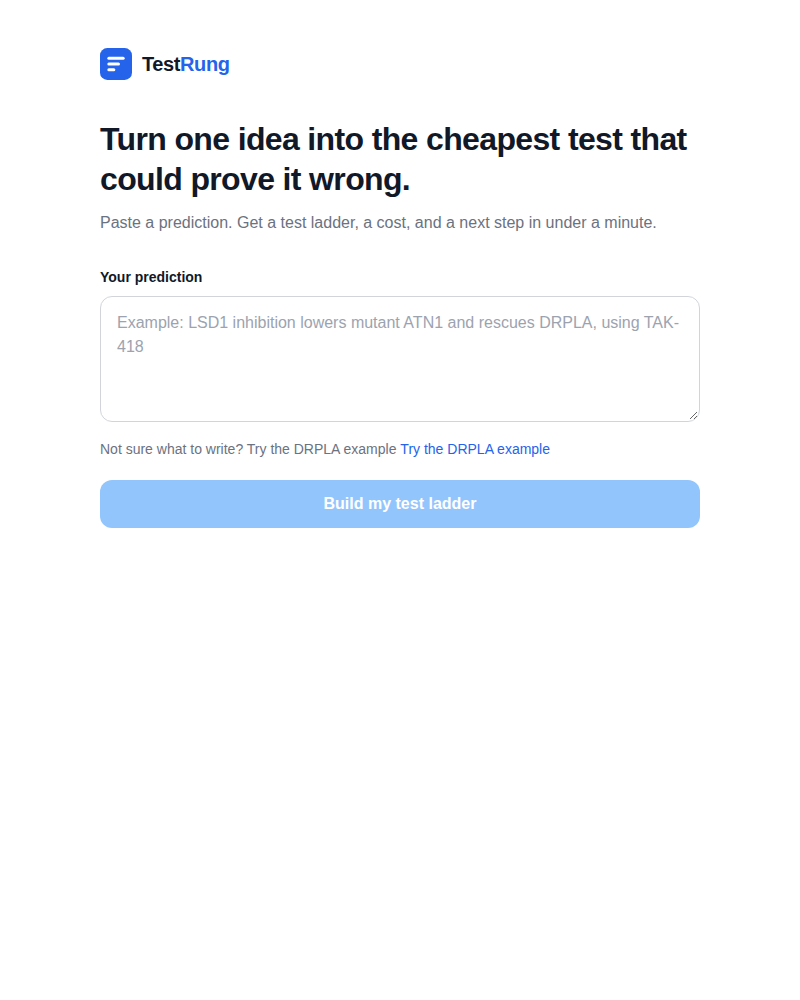
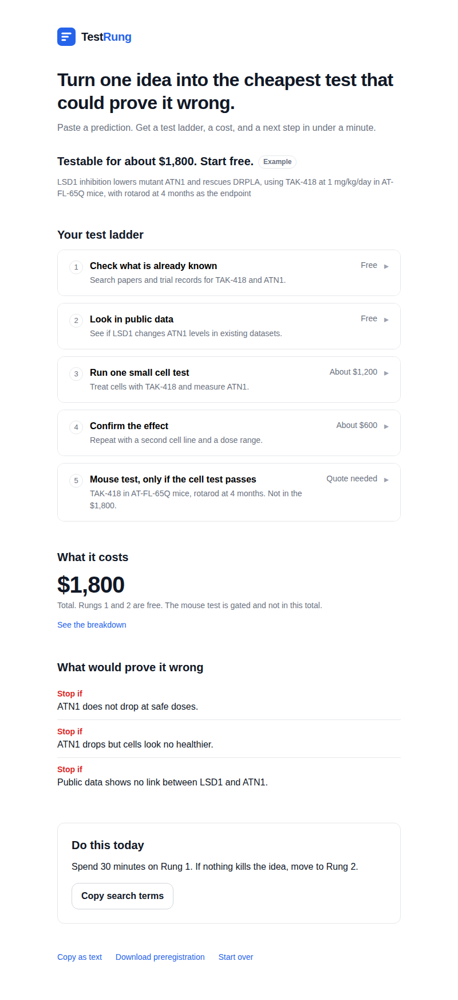
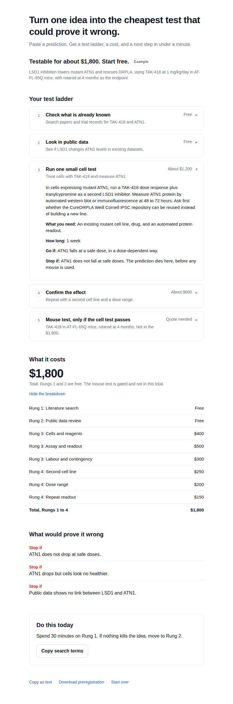
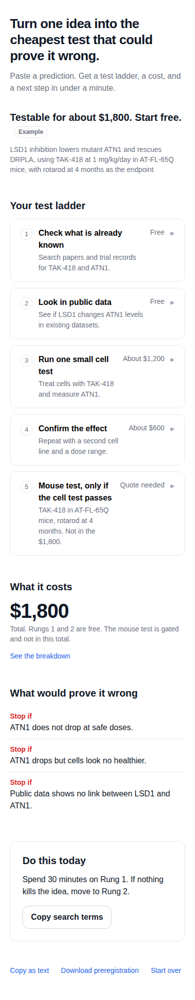
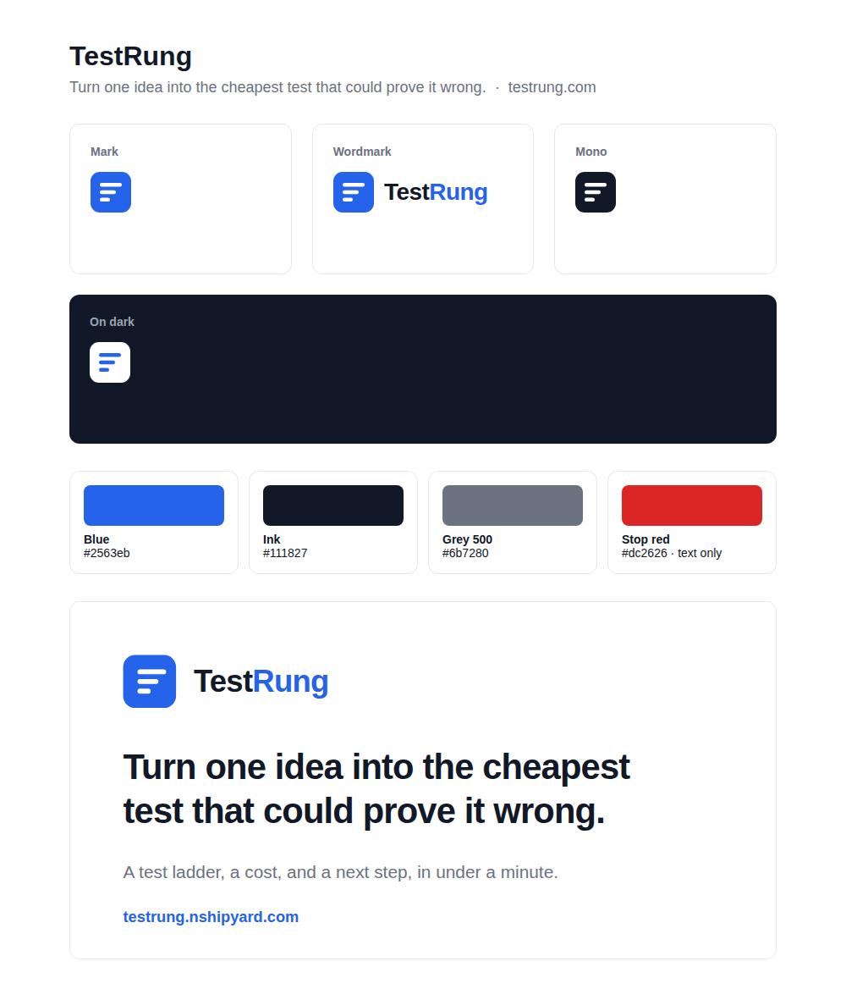

<p align="center">
  
</p>

<h1 align="center">TestRung</h1>

<p align="center"><strong>Turn one idea into the cheapest test that could prove it wrong.</strong></p>

<p align="center">
  A test ladder, a cost, and a next step, in under a minute.<br>
  For rare-disease researchers, unfunded labs, and anyone who has to prove an idea before they can afford to believe it.
</p>

<p align="center">
  <a href="LICENSE"></a>
  
  
  
  
</p>

<p align="center">
  <a href="#try-it-in-2-minutes"><strong>Try it in 2 minutes</strong></a> ·
  <a href="#how-it-works">How it works</a> ·
  <a href="#the-drpla-example">The DRPLA example</a> ·
  <a href="#where-is-it-cheapest-to-run">Cheapest place to run it</a> ·
  <a href="#contributing">Contributing</a>
</p>

<p align="center">
  Read this in: English · <a href="README.fr.md">Français</a> · <a href="README.es.md">Español</a>
</p>

---

## The problem

A lab test is expensive long before it is hard. Breeding and housing mice for four months, daily dosing, behavioural testing, and skilled hands cost far more than the drug. Most predictions never get tested at all, not because they are wrong, but because the first test anyone proposes is the most expensive one.

TestRung starts from the opposite end. It asks: what is the cheapest test that could prove this idea wrong, and what does it cost?

This project began with a real case. RareGap predicted that inhibiting LSD1 would lower mutant atrophin-1 and rescue DRPLA, a rare neurodegenerative disease. The test was written up and sent to the Ross lab at Johns Hopkins. The lab replied that it would be happy to advise, but it had no spare funds to run the experiment. That is the normal case, not the exception. TestRung is built for it.

## How it works

Paste a prediction. Get a ladder, cheapest first.

1. **Paste a prediction**, or tap "Try the DRPLA example".
2. **Tap "Build my test ladder".**
3. **Read the verdict first.** One line, one total cost.
4. **Open one rung at a time**, cheapest first. Rungs 1 and 2 are free.
5. **Read what would kill the idea.** Every ladder lists its "Stop if" criteria.
6. **Do the next step today.** The app tells you what to do in the next 30 minutes, and gives you the search terms to do it.

No account. No dashboard. No settings. One screen, one action.



## The DRPLA example

The pre-loaded example is the real RareGap prediction:

> LSD1 inhibition lowers mutant ATN1 and rescues DRPLA, using TAK-418 at 1 mg/kg/day in AT-FL-65Q mice, with rotarod at 4 months as the endpoint

The ladder it produces:

| Rung | Test | Cost |
| --- | --- | --- |
| 1 | Check what is already known. Search papers and trial records for TAK-418 and ATN1. | Free |
| 2 | Look in public data. See if LSD1 changes ATN1 levels in existing datasets. | Free |
| 3 | Run one small cell test. Treat cells with TAK-418 and measure ATN1. | About $1,200 |
| 4 | Confirm the effect. Repeat with a second cell line and a dose range. | About $600 |
| 5 | Mouse test, only if the cell test passes. TAK-418 in AT-FL-65Q mice, rotarod at 4 months. | Quote needed, locked |

**Total, Rungs 1 to 4: about $1,800.** The mouse test is not in the total. It is locked until the cell test passes, because if ATN1 does not fall in cells, the mouse spend is wasted.



What would prove it wrong:

- **Stop if** ATN1 does not drop at safe doses.
- **Stop if** ATN1 drops but cells look no healthier.
- **Stop if** public data shows no link between LSD1 and ATN1.



The cost breakdown is one tap away, line by line. Nothing is hidden in a round number.



## Where is it cheapest to run?

The next feature, designed with Opus 5.5, is a Numbeo-style comparison for each rung: where in the world is it cheapest to run this test, and is the saving real?

The honest version, not a league table. Full design in [`docs/cheapest-place-brainstorm.md`](docs/cheapest-place-brainstorm.md). The short version:

- **Rank providers, not nations.** Cost varies more between providers than between countries. A university core in Spain and a CRO in China are not the same kind of row.
- **Sort by landed cost.** Price, plus shipping and customs, plus one expected repeat. Time to result is its own column, never converted into dollars.
- **Every price carries a label.** Quote, Published rate, Estimate, or Placeholder. A row with no basis shows "Quote needed" instead of a guessed number.
- **Three rows at most**, with the US baseline always pinned. No ranked list of 40 countries.
- **Rungs 3 and 4 only, in v1.** The mouse rung gets "Where can this run? (quote only)", with ethics lead time and no prices, because that is where data is thinnest and the trap is biggest.

The example, for the DRPLA cell test:

| Place | Landed | Result in | Basis |
| --- | --- | --- | --- |
| US, academic core or CRO (baseline) | $1,200 | 3 wk | Estimate |
| Spain or Portugal, university core | ~$780 | 5 wk | Estimate |
| China, contract CRO | Quote needed | 4 to 6 wk | Placeholder, no number shown |

Reagents cost about the same everywhere. Savings come from labour. That is the whole insight, and the design says so in one line.

If you have a real price, a published core rate, or a dated quote, that is the most valuable contribution you can make. See [Contributing](#contributing).

## Try it in 2 minutes

You need Node 20 or newer. Nothing else.

```bash
git clone https://github.com/richardsondx/testrung.git
cd testrung
npm install
npm run dev
```

Open http://localhost:3000

That is the whole setup. There is no database, no API key, and no account to create.

To run the production build:

```bash
npm run build
npm start
```

## What this is, and what it is not

**It is:**

- A deterministic, rules-based ladder in [`lib/ladder.ts`](lib/ladder.ts). The ladder, the costs, and the kill criteria are checkable without trusting a model.
- A preregistration draft you can download, and a plain-text copy of the ladder.
- Open source, MIT licensed. Use it, fork it, teach with it.

**It is not:**

- A model call. v1 does not call any AI model and does not store anything on a server. The generation interface in [`lib/generate.ts`](lib/generate.ts) is the one place a model plugs in for v2, with Gemini 4 Neon as the planned first generator.
- A quote from a real lab. Costs are planning estimates, not quotes. A lab must review the preregistration draft before use.
- A substitute for the mouse test. A cell result that looks good does not guarantee a brain rescue. The ladder is a gate, not a replacement.

## Who this is for

- **Rare-disease researchers** with a prediction and no budget for the full animal study.
- **Unfunded labs and small teams** who need to kill bad ideas cheaply and spend on the survivors.
- **Drug discovery and preclinical teams** who want a falsifiable, preregistered first step before a CRO quote.
- **Students and teachers** who want a concrete example of falsification, experimental design, and the 3Rs (replace, reduce, refine animal use).
- **Open science contributors** who can add a real price, a better rung, or a cleaner kill criterion.

Keywords: rare disease, DRPLA, preclinical, drug discovery, falsification, experimental design, open science, lab cost, cell assay, animal reduction, 3Rs, preregistration, reproducibility, CRO, core facility.

## Project layout

```
app/page.tsx       the whole flow, one screen
app/globals.css    the visual system, plain CSS, no component library
app/icon.svg       the TestRung favicon
components/Logo.tsx  the TestRung mark and wordmark
lib/ladder.ts      the ladder engine, cost model, kill criteria, export text
lib/generate.ts    the generation interface, ready for Gemini 4 Neon in v2
lib/strings.ts     all user-facing copy in one place
brand/             logo, wordmark, favicon, social card, brand guide
docs/              cheapest-place brainstorm, design notes
screenshots/        the visual showcase used in this README
ARCHITECTURE.md    architecture, and an honest note on the Neon attempt
```

## Brand

TestRung. Blue rounded square, three white bars shrinking left to right, cost going down. Ink `#111827`, Blue `#2563eb`, Grey 500 `#6b7280`, red `#dc2626` for "Stop if" text only. Inter or system type. Full guide in [`brand/BRAND.md`](brand/BRAND.md).



Domain: **testrung.nshipyard.com**. No new domain to buy, it is a subdomain of nshipyard.com, to be pointed at the host when deployed.

## Contributing

Contributions are welcome, and small ones are best. The most valuable contribution is a real price with a source and a date.

Read [`CONTRIBUTING.md`](CONTRIBUTING.md) first. In short: fork, branch from `main`, keep the build green (`npm run build`), keep the UI minimal, never invent a number, and open a pull request with one change in it.

What helps most, in order: a real price, a better rung, a kill criterion, a bug fix, a clearer sentence.

## Author

**Richardson Dackam** — founder of [RareGap](https://raregap.ai), builder and systems thinker.

- GitHub: [github.com/richardsondx](https://github.com/richardsondx)
- LinkedIn: [linkedin.com/in/richardsondx](https://www.linkedin.com/in/richardsondx)
- Project: [RareGap](https://raregap.ai)

TestRung started as the Cheap-Test Converter, built after the Ross lab at Johns Hopkins said it would advise on the DRPLA test but had no spare funds to run it.

## License

MIT. See [LICENSE](LICENSE). Copyright 2026 Richardson Dackam.

## Acknowledgements

Built for [RareGap](https://raregap.ai), which maps rare-disease biology to ranked, testable hypotheses. The DRPLA prediction and the Ross lab exchange are the reason this tool exists. UI spec by Opus 5.5. Cheapest-place design by Opus 5.5. Architecture notes in [`ARCHITECTURE.md`](ARCHITECTURE.md) are honest about what Gemini 4 Neon did and did not return on the first attempt.
